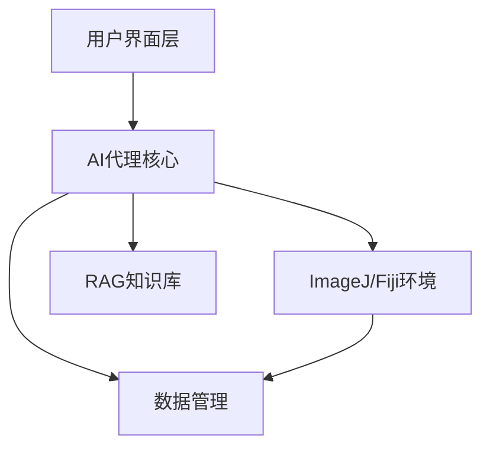
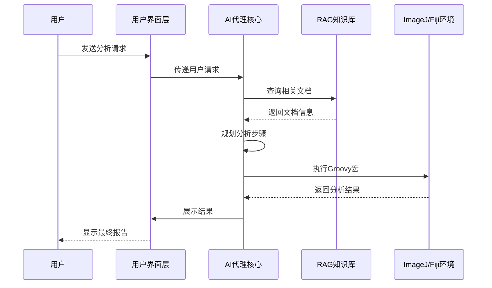

# Architecture

**Type:** client-server

Agentic-J采用客户端-服务器架构，其中Docker容器作为服务器运行ImageJ/Fiji和AI代理，用户通过Web浏览器中的noVNC界面与系统交互。系统利用LLM驱动的智能体来规划分析、编写和执行Groovy宏，并通过RAG系统检索插件文档。

## Component Diagram

## Components

### 用户界面层

提供noVNC虚拟桌面和聊天面板，让用户与AI代理交互

Files: `gui_runner.py`, `docs/index.html`, `docs/js/main.js`, `docs/css/styles.css`

### AI代理核心

处理用户请求、规划分析步骤、生成和执行Groovy脚本

Files: `src/imagentj/agents.py`, `run.py`, `gui_runner.py`

### ImageJ/Fiji环境

在容器中运行ImageJ/Fiji，提供图像分析功能

Files: `Dockerfile`, `docker-compose.yml`, `docker-entrypoint.sh`

### RAG知识库

存储和检索插件文档，支持智能体查询

Files: `skills/`, `qdrant_data/`

### 数据管理

处理图像数据输入和输出

Files: `data/`, `setup_wizard.py`

## Sequence Diagram

## Data Flow

用户通过noVNC界面发送图像分析请求，AI代理接收请求后查询RAG知识库获取相关插件文档，然后规划分析步骤并生成Groovy宏。生成的宏在容器内的ImageJ/Fiji环境中执行，处理用户提供的图像数据，最终将分析结果和可视化返回给用户界面。
