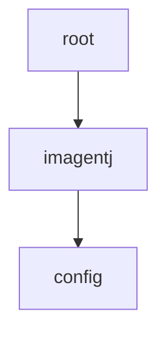

# 模块依赖

## 核心文件（按 PageRank 排序）

1. `src/config/imagej_config.py`
2. `src/imagentj/imagej_context.py`
3. `src/config/rag_config.py`
4. `src/imagentj/tracker.py`
5. `src/imagentj/rag/loaders.py`
6. `src/imagentj/agents.py`
7. `src/imagentj/benchmark_gui_hooks.py`
8. `src/imagentj/chat_history.py`
9. `src/imagentj/stop_signal.py`
10. `src/imagentj/tools/analyst_tools.py`

## 可能的入口点

- `Dockerfile`
- `README.md`
- `docker-compose.yml`
- `docs/README.md`
- `pyproject.toml`
- `user_guide/README.md`
- `docs/js/main.js`
- `run.py`
- `.codegraph/.gitignore`
- `.dockerignore`