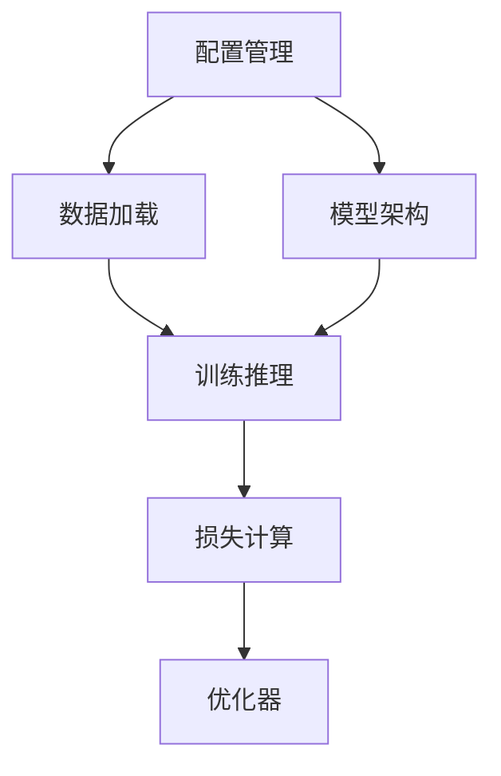
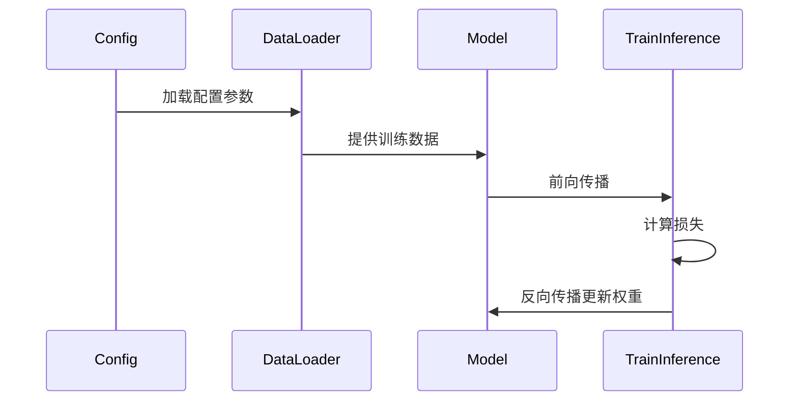

# Architecture

**Type:** pipeline

这是一个基于PyTorch Lightning的深度学习训练与推理管道，采用SDF（有符号距离函数）表示法进行边界感知实例分割。系统通过YAML配置文件管理数据、模型和训练参数，将图像输入到UNet网络中，输出SDF预测并计算多种损失函数进行优化。

## Component Diagram

## Components

### 配置管理

管理实验参数和超配置

Files: `unet2d.yml`, `utils.py`

### 数据加载

处理显微镜图像数据和增强

Files: `dataset.py`

### 模型架构

实现UNet网络和边界感知模块

Files: `models/unet.py`, `models/base_model.py`, `models/blocks.py`

### 训练推理

执行模型训练和测试流程

Files: `train_unet.py`

## Sequence Diagram

## Data Flow

配置文件定义实验参数，数据加载模块读取显微镜图像并进行增强处理。图像数据输入到UNet模型中生成SDF预测，训练模块计算交叉熵、MSE和MHD损失，通过反向传播优化模型参数，最终输出分割结果。
