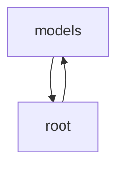

# 模块依赖

## 核心文件（按 PageRank 排序）

1. `utils.py`
2. `dataset.py`
3. `models/unet.py`
4. `README.md`
5. `requirements.txt`
6. `.codegraph/.gitignore`
7. `LICENSE`
8. `models/base_model.py`
9. `models/blocks.py`
10. `train_unet.py`

## 可能的入口点

- `README.md`
- `requirements.txt`
- `.codegraph/.gitignore`
- `LICENSE`
- `dataset.py`
- `models/base_model.py`
- `models/blocks.py`
- `models/unet.py`
- `train_unet.py`
- `unet2d.yml`