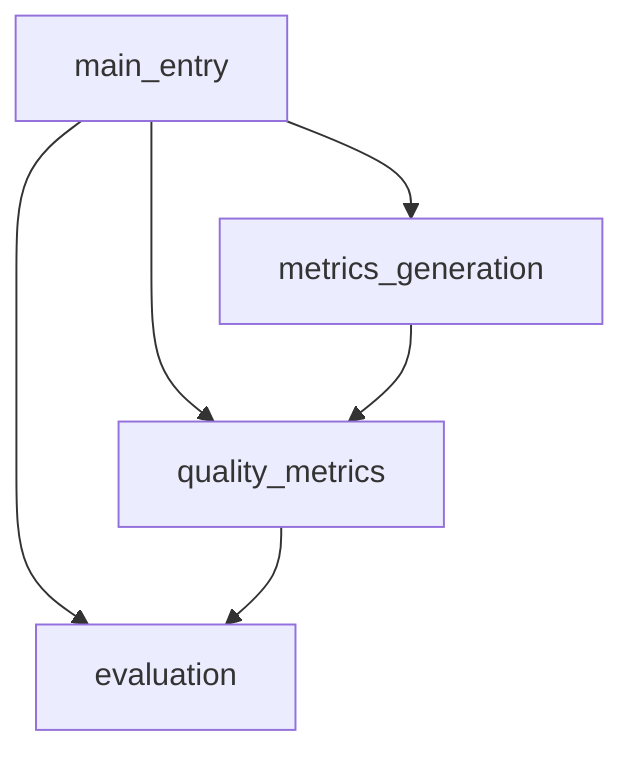
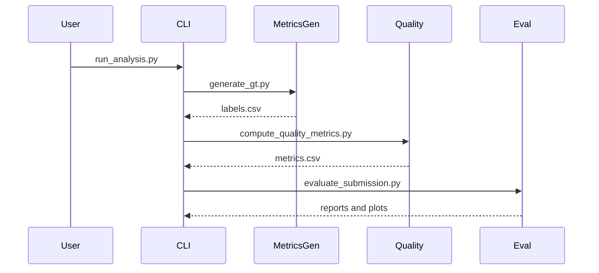

# 架构

**类型:** 命令行工具

这是一个专为评估和分析细胞行为视频分类挑战中视频分类提交而设计的命令行界面 (CLI) 工具。它提供了用于生成真实标签、计算视频质量指标以及将模型预测与真实数据对比评估的脚本。

## 组件图

## 组件

### main_entry

运行分析流程的主入口点

文件：`run_analysis.py`, `eval_code.php`

### metrics_generation

从数据集文件夹结构生成真实标签 CSV 文件

文件：`metrics/generate_gt.py`

### quality_metrics

计算视频质量指标，如信噪比 (SNR) 和细胞追踪计数

文件：`metrics/compute_quality_metrics.py`, `metrics/descriptives.py`, `metrics/ncell_curves.py`, `metrics/snr_curves.py`

### evaluation

评估提交预测并生成性能报告与图表

文件：`metrics/overall_metrics.py`, `metrics/roc_curves.py`, `metrics/upload_files.py`

## 序列图

## 数据流

用户运行主 CLI 脚本来编排整个流程。首先，从数据集文件夹结构生成真实标签。然后，利用追踪文件计算视频质量指标。最后，将这些指标与提交预测结合，用于评估模型性能，并生成包含 ROC 曲线及其他可视化的报告。