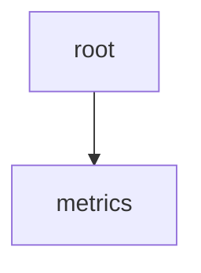

# 模块依赖

## 核心文件（按 PageRank 排序）

1. `metrics/descriptives.py`
2. `metrics/ncell_curves.py`
3. `metrics/overall_metrics.py`
4. `metrics/roc_curves.py`
5. `metrics/snr_curves.py`
6. `metrics/upload_files.py`
7. `README.md`
8. `.codegraph/.gitignore`
9. `LICENSE`
10. `environment.yml`

## 可能的入口点

- `README.md`
- `.codegraph/.gitignore`
- `LICENSE`
- `environment.yml`
- `eval_code.php`
- `metrics/compute_quality_metrics.py`
- `metrics/descriptives.py`
- `metrics/generate_gt.py`
- `metrics/ncell_curves.py`
- `metrics/overall_metrics.py`