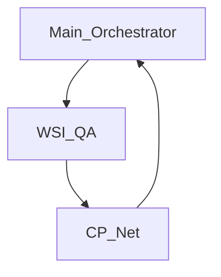
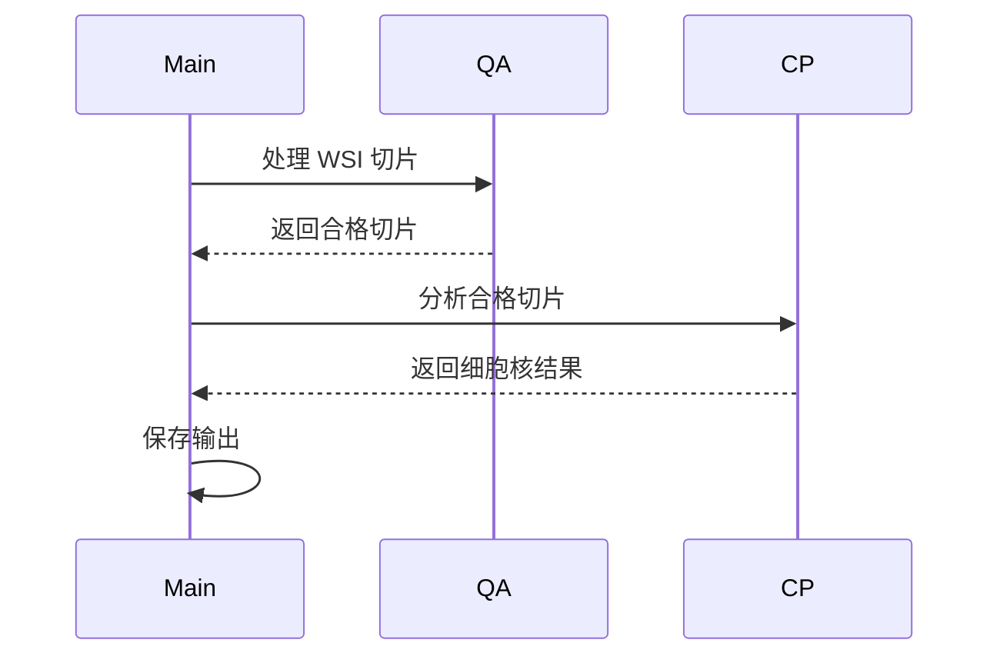

# 架构

**类型：** 流水线

CellQuant-Net 是一个用于计算病理学全切片图像分析的多阶段流水线。它集成了一个质量评估模块以过滤包含伪影的图像，随后是一个轻量级的细胞核检测与分类模型（CP-Net），最后通过连通性分析来计算定量指标。

## 组件图

## 组件

### WSI_QA

质量评估模块，用于过滤掉包含模糊或褶皱等伪影的低质量图像切片。

文件：`WSI_QA/config.py`, `WSI_QA/datasets/dataset.py`, `WSI_QA/network/ConvNeXt/ConvNeXt.py`, `WSI_QA/network/ConvNeXt/ConvNeXtUnet.py`, `WSI_QA/network/DHUnet.py`, `WSI_QA/network/SwinTransformer/SwinTransformer.py`, `WSI_QA/network/SwinTransformer/SwinUnet.py`, `WSI_QA/network/TransFuse/DeiT.py`, `WSI_QA/network/TransFuse/TransFuse.py`, `WSI_QA/network/UNet/Unet.py`, `WSI_QA/network/UperNet/upernet_convnext_tiny.py`, `WSI_QA/patch_analyze.py`, `WSI_QA/test_qa.py`, `WSI_QA/utils.py`

### CP_Net

核心细胞核检测与分类引擎，采用轻量级 CNN 和苏木精染色通道先验知识。

文件：`CP-Net/cell_connectivitey.py`, `CP-Net/dataset.py`, `CP-Net/model/model.py`, `CP-Net/model/unirepLKnet.py`, `CP-Net/post_process.py`, `CP-Net/qupath_jsn.py`, `CP-Net/spli_H.py`, `CP-Net/test_cp_net.py`

### Main_Orchestrator

入口点脚本，负责协调 QA 和 CP-Net 模块并管理执行参数。

文件：`run_cellquant_net.py`, `verify_installation.py`

## 序列图

## 数据流

流水线始于摄入全切片图像，这些图像被传递给 WSI_QA 模块以过滤伪影。剩余的高质量切片随后由 CP-Net 处理以进行细胞核检测与分类。最后，主协调器汇总结果并将其保存到输出目录。