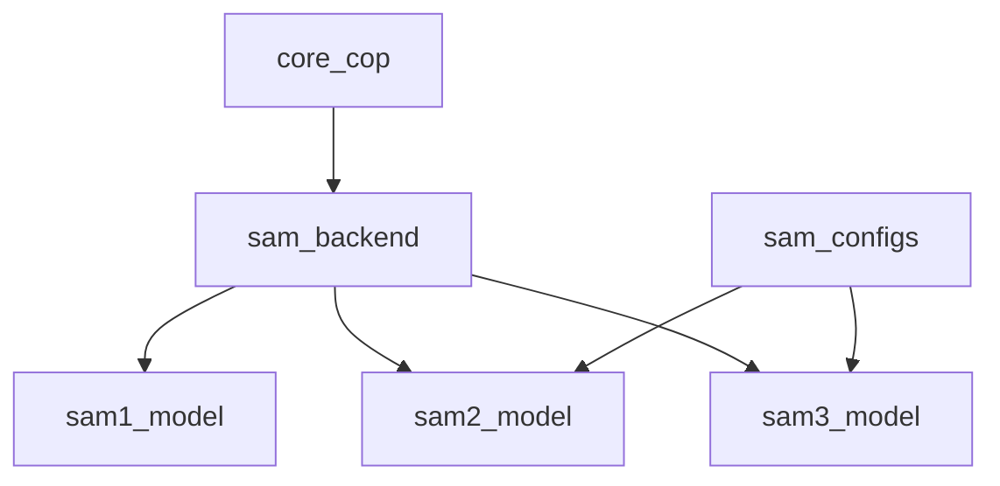
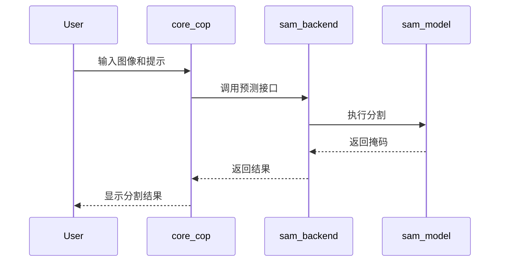

# Architecture

**Type:** library

这是一个基于SAM（Segment Anything Model）的库，实现了Chain-of-Prompts (CoP) 方法，用于细胞实例分割。核心组件包括SAM模型的不同版本实现（SAM1、SAM2、SAM3）以及统一的预测器接口。

## Component Diagram

## Components

### core_cop

实现Chain-of-Prompts核心算法

Files: `core/cop.py`

### sam_backend

提供SAM模型的不同版本实现和统一接口

Files: `core/sam/__init__.py`, `core/sam/predictor.py`, `core/sam/utils/__init__.py`

### sam1_model

SAM1模型实现

Files: `core/sam/modeling/sam1/sam.py`, `core/sam/modeling/sam1/image_encoder.py`, `core/sam/modeling/sam1/mask_decoder.py`, `core/sam/modeling/sam1/prompt_encoder.py`

### sam2_model

SAM2模型实现，包含记忆编码和注意力机制

Files: `core/sam/modeling/sam2/sam2_base.py`, `core/sam/modeling/sam2/memory_encoder.py`, `core/sam/modeling/sam2/memory_attention.py`

### sam3_model

SAM3模型实现，支持视频跟踪和文本编码

Files: `core/sam/modeling/sam3/model/sam3_image.py`, `core/sam/modeling/sam3/model/sam3_tracker_base.py`, `core/sam/modeling/sam3/model/text_encoder_ve.py`

### sam_configs

SAM模型的配置文件

Files: `core/sam/configs/sam2_hiera_b+.yaml`, `core/sam/configs/sam2.1_hiera_l.yaml`

## Sequence Diagram

## Data Flow

用户通过接口输入图像和提示（点击），Chain-of-Prompts算法处理提示并生成组提示，统一SAM接口根据配置选择适当的SAM模型版本执行分割，最终返回实例掩码。
