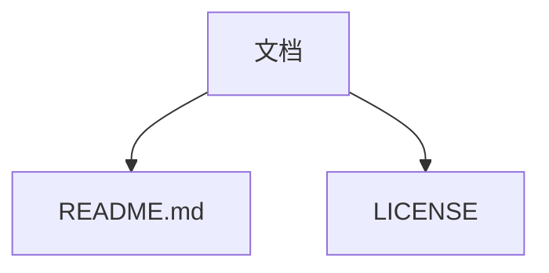

# 架构

**类型：** 库

该项目似乎是一个名为 ContiStain 的库或框架，目前尚无实现代码。其结构仅包含文档和许可证文件，表明这是一个占位符或处于早期开发阶段。

## 组件图



## 组件

### 文档

提供项目信息和许可说明

文件：`README.md`、`LICENSE`

## 序列图

```mermaid
sequenceDiagram
  participant 用户
  participant 文档
  用户->>文档：阅读文档
  文档-->>用户：项目信息
```

## 数据流

由于不存在功能性代码，因此没有数据流。该项目目前仅包含描述预期库的静态文档文件。