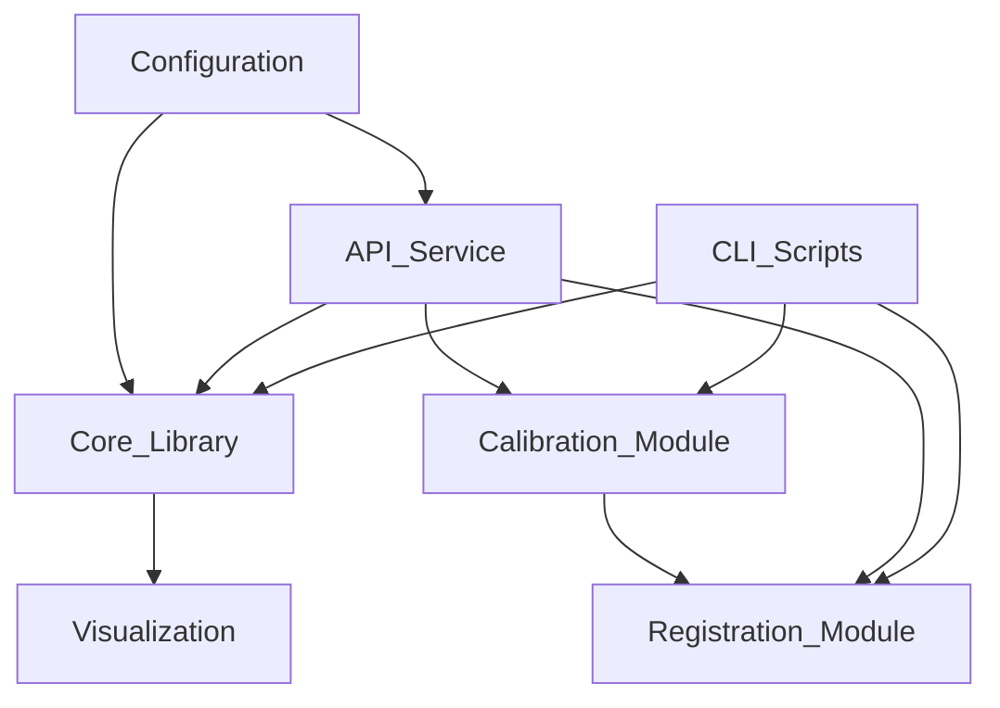
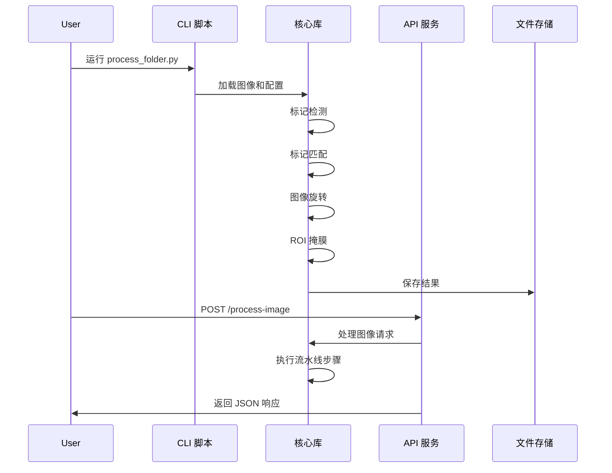

# 架构

**类型：** 流水线

DART-MLCI 实现了一个用于微流控芯片分析的模块化图像处理流水线，结合了标记检测、几何对齐和细胞分割。该系统支持命令行工具（CLI）和 FastAPI 服务，核心处理逻辑与编排脚本之间有着清晰的分离。

## 组件图

## 组件

### core_library

核心图像处理与分析逻辑

文件：`dart_mlci/__init__.py`, `dart_mlci/analysis.py`, `dart_mlci/chip.py`, `dart_mlci/detection.py`, `dart_mlci/mask.py`, `dart_mlci/match.py`, `dart_mlci/rotation.py`, `dart_mlci/pipeline.py`

### calibration_module

标定与坐标系对齐

文件：`dart_mlci/calibration/__init__.py`, `dart_mlci/calibration/core.py`, `dart_mlci/calibration/validation.py`, `dart_mlci/map.py`

### registration_module

图像配准与对齐算法

文件：`dart_mlci/registration/__init__.py`, `dart_mlci/registration/_base.py`, `dart_mlci/registration/_ncc.py`, `dart_mlci/registration/_phase_corr.py`

### api_service

用于远程处理的 FastAPI REST API

文件：`dart_mlci/api/main.py`, `dart_mlci/api/models.py`, `dart_mlci/api/settings.py`, `dart_mlci/api/utils.py`

### cli_scripts

用于批量处理和分析的命令行工具

文件：`scripts/process_folder.py`, `scripts/process_experiment.py`, `scripts/calibrate_map.py`, `scripts/batch_masking.py`, `scripts/benchmark.py`, `scripts/analyze_growth.py`

### visualization

图像渲染与视频生成

文件：`dart_mlci/visualization/__init__.py`, `dart_mlci/visualization/drawing.py`, `dart_mlci/visualization/plotting.py`, `dart_mlci/visualization/rendering.py`, `dart_mlci/visualization/video.py`

### configuration

统一的配置管理

文件：`dart_mlci/config.py`, `dart_mlci/constants.py`, `dart_mlci/types.py`

## 序列图

## 数据流

图像从输入源（TIFF 堆栈或单张图像）开始，流经一个顺序流水线：使用 YOLO 进行标记检测、十字/圆形标记的几何匹配、旋转校正以及 ROI 掩膜。处理后的数据可进一步用于细胞分割和生长统计分析，结果以 CSV 文件和可视化形式存储。