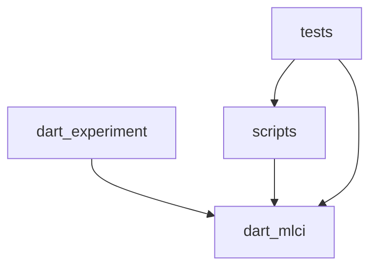

# 模块依赖

## 核心文件（按 PageRank 排序）

1. `dart_mlci/__init__.py`
2. `dart_mlci/mask.py`
3. `dart_mlci/artifacts.py`
4. `dart_mlci/utils.py`
5. `dart_mlci/constants.py`
6. `dart_mlci/visualization/drawing.py`
7. `dart_mlci/visualization/video.py`
8. `dart_mlci/test_utils/image_comparison.py`
9. `dart_mlci/chip.py`
10. `dart_mlci/types.py`

## 可能的入口点

- `Dockerfile`
- `README.md`
- `dart_mlci/config.py`
- `docker-compose.yml`
- `pyproject.toml`
- `requirements.txt`
- `scripts/analyze_growth.py`
- `scripts/batch_masking.py`
- `scripts/benchmark.py`
- `scripts/calibrate_pixel_scale.py`