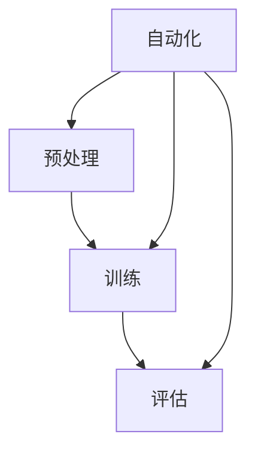
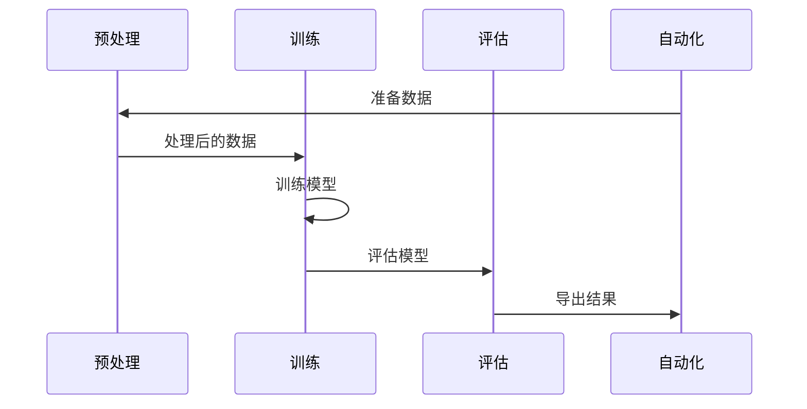

# 架构

**类型：** 流水线

DriftST 是一个用于从 H&E 组织学图像推断空间转录组学的深度学习流水线。它遵循结构化的工作流程，包含独立的预处理、训练和评估阶段，同时支持细胞级和斑点级的数据格式。

## 组件图

## 组件

### 预处理

从原始空间转录组学和组织学数据进行数据准备和特征提取

文件：`process/preprocess_spot_level.py`、`process/preprocess_xenium_cell_level.py`、`process/select_xenium_cell_level_genes.py`、`process/select_xenium_cell_level_hvg.py`、`process/generate_xenium_cell_level_splits.py`、`process/compute_spatial_variable_genes.py`

### 训练

使用漂移目标函数和空间注意力机制进行模型训练

文件：`train.py`、`src/model.py`、`src/drift_step.py`、`src/dataset.py`

### 评估

模型评估与结果导出，包含质量指标

文件：`test.py`、`src/evaluation.py`、`src/postprocess.py`

### 自动化

工作流编排与实验管理

文件：`scripts/run_spot_level_train.sh`、`scripts/run_xenium_cell_level_preprocess.sh`、`scripts/run_xenium_cell_level_train.sh`、`scripts/run_xenium_coad_cell_level_train.sh`

## 序列图

## 数据流

原始组织学和转录组数据通过预处理脚本流动，生成标准化的 `processed_data` 格式，包含图像特征和基因表达矩阵。训练流水线加载该数据，使用漂移目标函数训练 DriftST 模型并生成预测。最后，评估脚本计算指标并将结果以 h5ad 格式导出，以便进行下游分析。