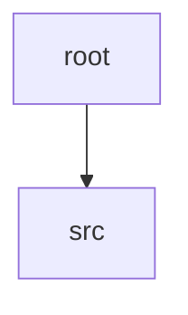

# 模块依赖

## 核心文件（按 PageRank 排序）

1. `src/dataset.py`
2. `src/evaluation.py`
3. `src/model.py`
4. `src/drift_step.py`
5. `src/postprocess.py`
6. `README.md`
7. `requirements.txt`
8. `scripts/run_spot_level_train.sh`
9. `scripts/run_xenium_cell_level_preprocess.sh`
10. `scripts/run_xenium_cell_level_train.sh`

## 可能的入口点

- `README.md`
- `requirements.txt`
- `scripts/run_spot_level_train.sh`
- `scripts/run_xenium_cell_level_preprocess.sh`
- `scripts/run_xenium_cell_level_train.sh`
- `scripts/run_xenium_coad_cell_level_train.sh`
- `.gitignore`
- `LICENSE`
- `environment.yml`
- `process/compute_spatial_variable_genes.py`