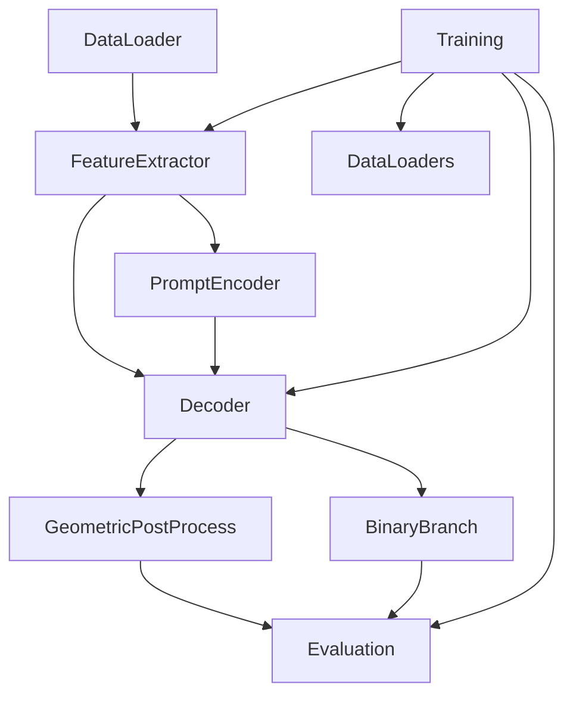
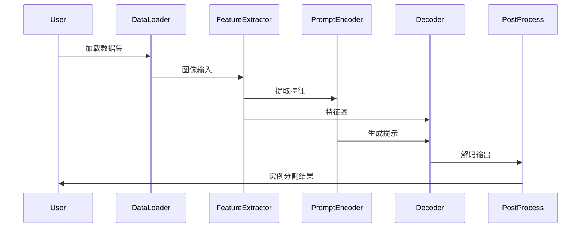

# Architecture

**Type:** pipeline

EffiCell-Seg采用基于特征提取的流水线架构，支持在线和缓存两种模式。核心由DINOv3骨干网络、自提示编码器、双分支解码器及可切换的几何分支组成，用于细胞实例分割。

## Component Diagram

## Components

### 数据加载与预处理

加载图像和标签，管理数据集划分

Files: `dataloader.py`, `utils.py`

### 特征提取模块

使用DINOv3提取图像特征，支持在线或缓存模式

Files: `extract_features.py`, `model.py`

### 提示编码器

基于类token相似性和PCA生成自提示

Files: `segment_anything/modeling/prompt_encoder.py`

### 双分支解码器

包含二值前景分支和几何分支，通过交叉注意力融合

Files: `segment_anything/modeling/mask_decoder.py`, `segment_anything/modeling/transformer.py`

### 几何后处理

根据选择的范式（tsfd/hovernet/stardist/cellpose）恢复实例

Files: `segment_anything/utils/amg.py`

### 训练与评估

模型训练、验证和指标计算

Files: `train.py`, `eval.py`, `metrics.py`

## Sequence Diagram

## Data Flow

数据首先通过数据加载器读取图像和标签，然后进入特征提取模块（可选预计算）。DINOv3骨干网络提取特征后，结合自提示编码器生成提示，送入双分支解码器。解码器的几何分支输出经后处理模块根据选定范式转换为实例分割结果，最终由评估模块计算性能指标。
