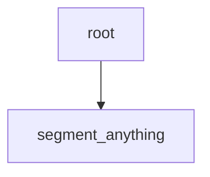

# 模块依赖

## 核心文件（按 PageRank 排序）

1. `segment_anything/modeling/__init__.py`
2. `dataloader.py`
3. `model.py`
4. `segment_anything/modeling/prompt_encoder.py`
5. `segment_anything/modeling/transformer.py`
6. `utils.py`
7. `metrics.py`
8. `README.md`
9. `.codegraph/.gitignore`
10. `.zread/wiki/drafts/wiki.json`

## 可能的入口点

- `README.md`
- `.codegraph/.gitignore`
- `.zread/wiki/drafts/wiki.json`
- `LICENSE`
- `eval.py`
- `extract_features.py`
- `metrics.py`
- `segment_anything/__init__.py`
- `segment_anything/automatic_mask_generator.py`
- `segment_anything/build_sam.py`