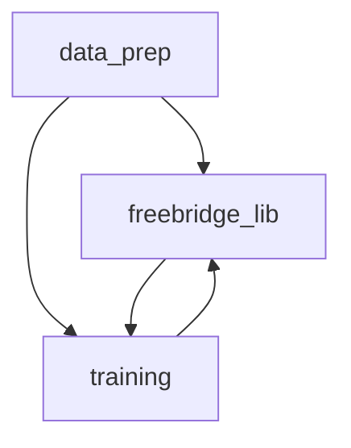
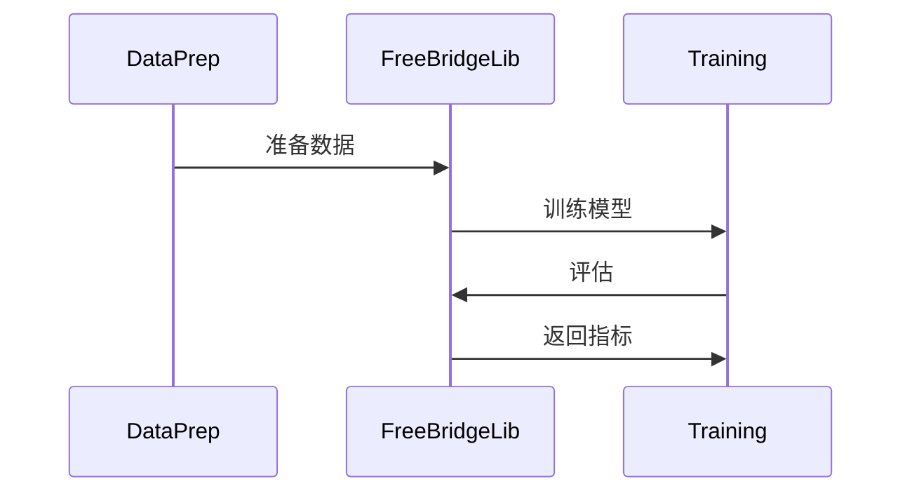

# 架构

**类型：** 流水线

FreeBridge 是一个深度学习流水线，用于使用 Schrödinger Bridge 公式对单细胞转换动力学进行建模。它包含数据准备、模型训练和评估阶段，并拥有一个用于实现变分桥匹配算法的核心库。

## 组件图

## 组件

### data_prep

单细胞图像和潜在表示的数据准备与预处理

文件：`data_prep/__init__.py`, `data_prep/build_bbbc021_endpoints.py`, `data_prep/cellvae_adapter.py`, `data_prep/crop_bbbc021_singlecell.py`, `data_prep/export_latents_from_vae.py`, `data_prep/export_latents_mu.py`, `data_prep/finetune_decoder_lpips.py`, `data_prep/gen_cells.py`, `data_prep/make_split.py`, `data_prep/train_vae_full.py`

### freebridge_lib

实现 FreeBridge 算法的核心库，包括 SDE、网络结构和损失函数

文件：`freebridge/__init__.py`, `freebridge/dataset.py`, `freebridge/ema.py`, `freebridge/evaluator.py`, `freebridge/experimental.py`, `freebridge/gaussian_path.py`, `freebridge/interp1d.py`, `freebridge/match_loss.py`, `freebridge/network.py`, `freebridge/nn.py`, `freebridge/opinion.py`, `freebridge/path_integral.py`, `freebridge/pl_model.py`, `freebridge/plotting.py`, `freebridge/sde.py`, `freebridge/state_cost.py`, `freebridge/unet.py`, `freebridge/utils.py`, `freebridge/vae.py`

### training

主训练脚本和配置管理

文件：`configs/experiment/bbbc021.yaml`, `configs/train.yaml`, `train.py`, `scripts/train.sh`, `sample_bbbc021_latents.py`

## 序列图

## 数据流

数据准备模块处理原始细胞图像并提取潜在表示，核心库实现 Schrödinger Bridge 的漂移场和损失计算，训练脚本协调数据加载、模型训练和评估流程。