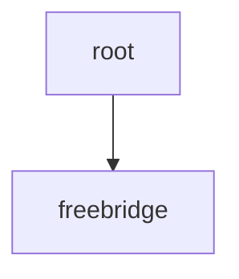

# 模块依赖

## 核心文件（按 PageRank 排序）

1. `freebridge/dataset.py`
2. `freebridge/pl_model.py`
3. `freebridge/utils.py`
4. `README.md`
5. `setup.py`
6. `scripts/train.sh`
7. `.codegraph/.gitignore`
8. `.gitignore`
9. `CONTRIBUTING.md`
10. `LICENSE.md`

## 可能的入口点

- `README.md`
- `setup.py`
- `scripts/train.sh`
- `.codegraph/.gitignore`
- `.gitignore`
- `CONTRIBUTING.md`
- `LICENSE.md`
- `configs/experiment/bbbc021.yaml`
- `configs/train.yaml`
- `data_prep/__init__.py`