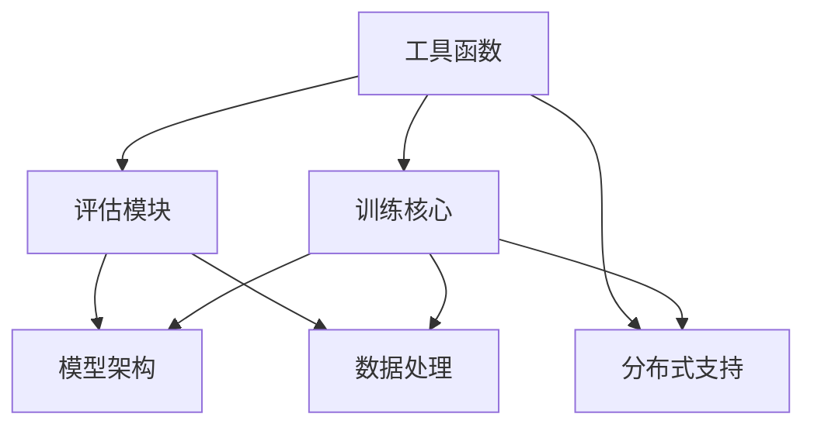
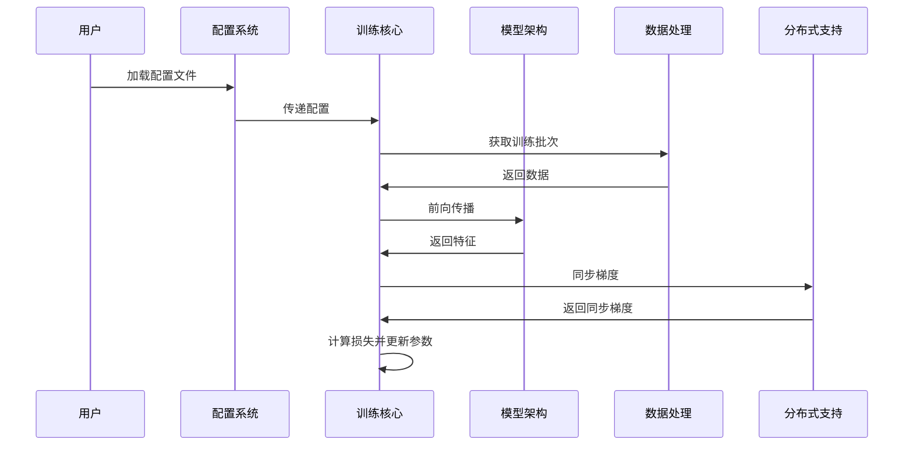

# Architecture

**Type:** framework

HASSL is a hierarchy-aware self-supervised learning framework built on top of DINOv3 for single cell microscopy. It uses a modular architecture with separate components for training, evaluation, data handling, and model definitions, following a typical PyTorch-based deep learning framework structure.

## Component Diagram

## Components

### 训练核心

负责模型训练流程、损失计算和优化器管理

Files: `dinov3/train/train.py`, `dinov3/train/ssl_meta_arch.py`, `dinov3/loss/`

### 模型架构

定义和加载各种神经网络模型

Files: `dinov3/models/`, `dinov3/layers/`

### 数据处理

处理图像数据加载、增强和批处理

Files: `dinov3/data/`, `dinov3/configs/`

### 评估模块

提供多种评估任务如KNN、线性探测、分割和检测

Files: `dinov3/eval/`

### 分布式支持

管理多GPU分布式训练

Files: `dinov3/distributed/`, `dinov3/fsdp/`

### 工具函数

提供日志、配置、检查点等通用功能

Files: `dinov3/logging/`, `dinov3/configs/config.py`, `dinov3/checkpointer/`

## Sequence Diagram

## Data Flow

配置系统读取YAML配置文件并转换为OmegaConf对象，训练核心根据配置初始化模型和数据加载器。训练过程中，数据处理模块加载图像批次并应用增强，模型架构执行前向传播生成特征表示。分布式支持模块在多GPU环境下同步梯度和参数，最终通过检查点模块保存训练状态。
