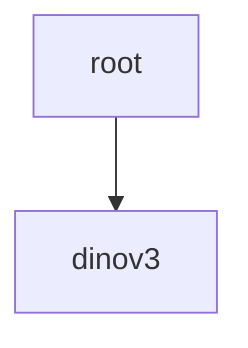

# 模块依赖

## 核心文件（按 PageRank 排序）

1. `dinov3/distributed/__init__.py`
2. `dinov3/utils/__init__.py`
3. `dinov3/layers/__init__.py`
4. `dinov3/configs/__init__.py`
5. `dinov3/eval/segmentation/models/utils/ms_deform_attn.py`
6. `dinov3/eval/segmentation/models/utils/position_encoding.py`
7. `dinov3/eval/dense/depth/utils.py`
8. `dinov3/logging/__init__.py`
9. `dinov3/eval/utils.py`
10. `dinov3/checkpointer/__init__.py`

## 可能的入口点

- `README.md`
- `dinov3/configs/config.py`
- `dinov3/eval/detection/config.py`
- `dinov3/eval/segmentation/models/utils/ops/setup.py`
- `pyproject.toml`
- `requirements.txt`
- `setup.py`
- `.codegraph/.gitignore`
- `.docstr.yaml`
- `.github/workflows/lint.yaml`