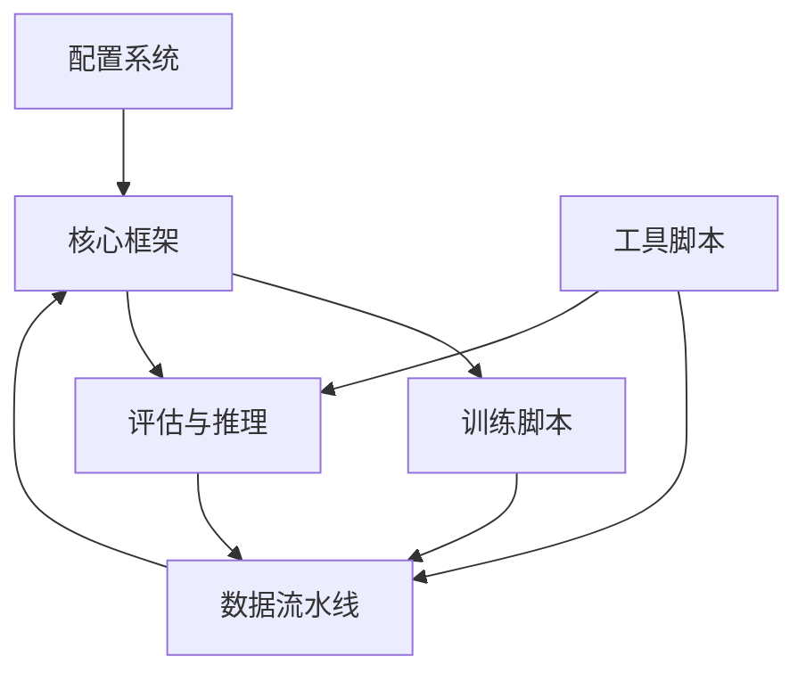
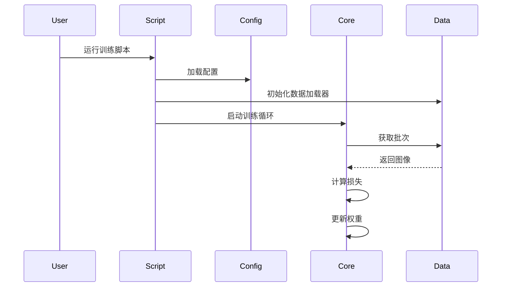

# 架构

**类型：** 流水线

这是一个基于 UVCGANv2 框架构建的深度学习图像到图像翻译流水线，专门针对 3D 虚拟组织病理学染色而设计。它采用模块化结构，将配置、数据加载、模型训练和评估分离为独立的组件。

## 组件图

## 组件

### 核心框架

提供基础的 GAN 实现，包括网络架构、损失函数和训练循环。

文件：`uvcgan2/__init__.py`，`uvcgan2/base/networks.py`，`uvcgan2/base/losses.py`，`uvcgan2/cgan/uvcgan2.py`，`uvcgan2/cgan/uvcgan2_3D_emb_sub_stylefusion.py`，`uvcgan2/train/train.py`

### 配置系统

通过分层配置对象管理超参数和数据集设置。

文件：`uvcgan2/config/config.py`，`uvcgan2/config/data_config.py`，`uvcgan2/config/model_config.py`

### 数据流水线

处理图像加载、预处理以及成对和无配对训练的数据集管理。

文件：`uvcgan2/data/datasets/image_domain_folder.py`，`uvcgan2/data/transforms.py`，`uvcgan2/data/loader_zipper.py`

### 训练脚本

用于预训练、微调以及使用特定模型变体恢复训练的入口点。

文件：`scripts/pretrain_BIT2HE.py`，`scripts/finetune_from_checkpoint_3D.py`，`scripts/resume_training_from_config_3D.py`

### 评估与推理

执行模型推理、指标计算（PSNR、SSIM、FID）以及图像翻译。

文件：`scripts/translate_A2B.py`，`scripts/eval_all_epochs_A2B_metrics.py`，`scripts/eval_fid.py`，`scripts/translate_images_3D.py`

### 工具脚本

支持数据准备、重建和文件管理。

文件：`scripts/downsize_right.py`，`scripts/reconstruct_bit_vhe_from_metadata.py`，`scripts/fix_double_tif_suffix.py`

## 序列图

## 数据流

流水线始于配置加载，该配置定义了数据集路径和模型超参数。随后，数据加载器获取并预处理图像对（BIT 和 H&E），并将其输入 GAN 核心以进行训练或推理。在训练过程中，生成器创建合成图像，判别器对其进行评估，而指标则在评估阶段单独计算。