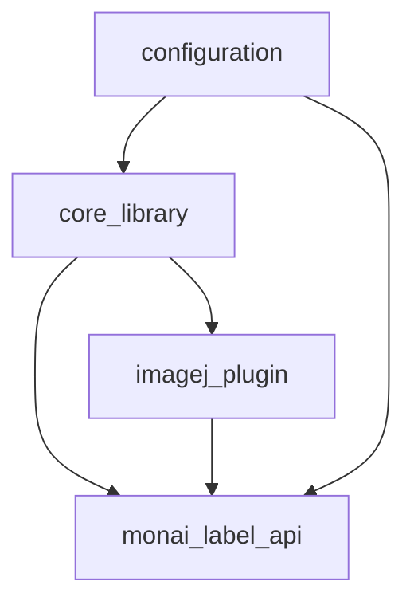
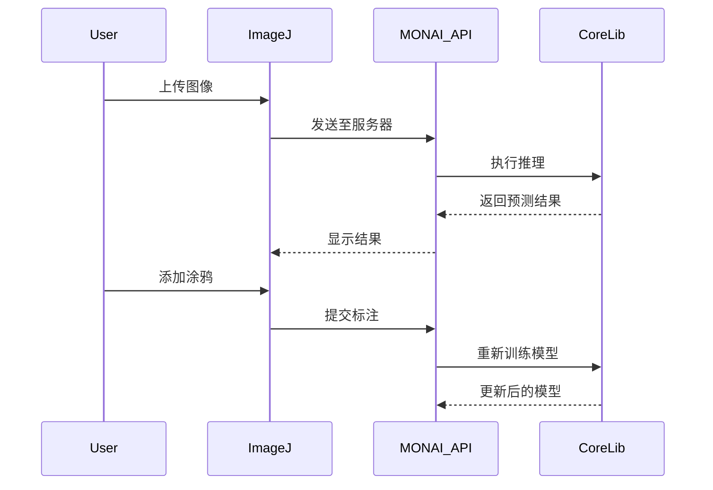

# 架构

**类型：** 插件系统

ImPartial 实现了基于插件的架构，与 MONAI Label 和 ImageJ/Fiji 集成。核心 Python 库提供深度学习模型和训练逻辑，而 ImageJ 插件则作为桌面客户端，用于交互式标注和推理。MONAI Label API 实现了服务器端模型服务和主动学习工作流。

## 组件图

## 组件

### core_library

包含模型、训练、推理和工具函数的核心 Python 库

文件：`impartial/dataprocessing/`、`impartial/general/`、`setup.py`、`requirements.txt`

### monai_label_api

用于模型服务和主动学习的 MONAI Label 服务器集成

文件：`monailabel-app/api/main.py`、`monailabel-app/api/lib/`、`monailabel-app/Impartial_classes.py`、`monailabel-app/Impartial_dataloaders.py`、`monailabel-app/Impartial_functions.py`

### imagej_plugin

通过 ImageJ/Fiji 进行交互式标注、训练和推理的桌面客户端

文件：`imagej-plugin/src/main/java/org/nadeemlab/impartial/`、`imagej-plugin/pom.xml`

### configuration

针对不同数据集和模型的配置文件

文件：`config/`、`impartial/general/config.py`

## 序列图

## 数据流

用户通过 ImageJ 插件上传图像，插件将其发送至 MONAI Label API 服务器。服务器使用核心库执行推理并返回预测结果。用户添加涂鸦作为部分标注，这些标注被发送回服务器以进行主动学习和模型重新训练。