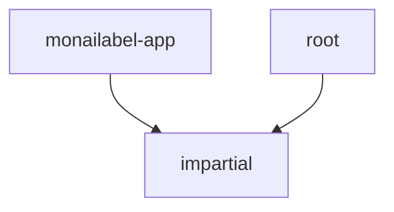

# 模块依赖

## 核心文件（按 PageRank 排序）

1. `impartial/general/utils.py`
2. `impartial/dataprocessing/utils.py`
3. `impartial/general/evaluation.py`
4. `impartial/general/outlines.py`
5. `impartial/general/metrics_stardist.py`
6. `impartial/general/metrics_cellpose.py`
7. `impartial/general/inference.py`
8. `impartial/dataprocessing/reader.py`
9. `impartial/general/training.py`
10. `impartial/general/config.py`

## 可能的入口点

- `Dockerfile`
- `README.md`
- `data/README.md`
- `imagej-plugin/README.md`
- `imagej-plugin/pom.xml`
- `impartial/general/config.py`
- `monailabel-app/api/README.md`
- `requirements.txt`
- `setup.py`
- `monailabel-app/api/main.py`