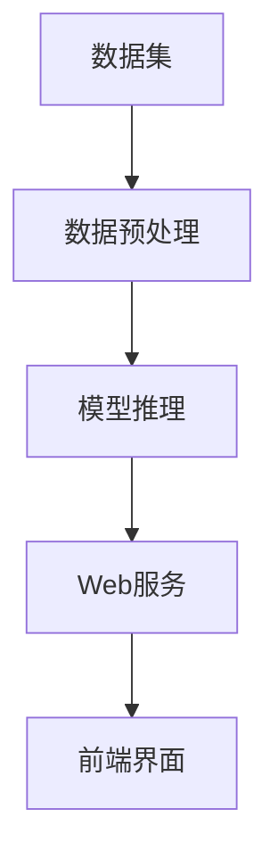
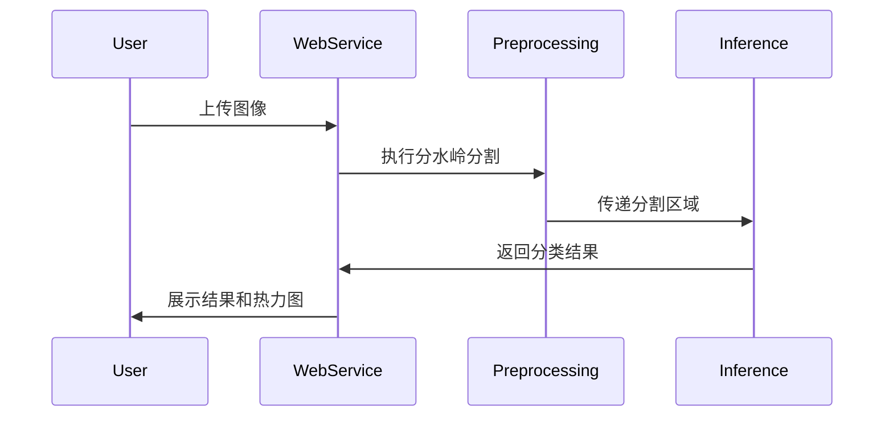

# Architecture

**Type:** pipeline

MalariAI采用两阶段解耦框架，第一阶段使用分水岭算法进行细胞分割，第二阶段利用EfficientNet-B0进行感染阶段分类。整个系统通过Web应用接口提供服务，支持图像上传和结果可视化。

## Component Diagram

## Components

### 数据预处理

图像增强和分割

Files: `Phase3-PipelineB/stage1_watershed.py`, `Phase3-PipelineB/gradcam.py`

### 模型推理

细胞分类和注意力可视化

Files: `Phase3-PipelineB/stage2_inference.py`, `Phase3-PipelineB/stage2_train.py`

### Web服务

提供API接口和前端界面

Files: `Phase4-WebApp/app.py`, `Phase4-WebApp/pipeline.py`, `Phase4-WebApp/malariai_medical_ui.html`

### 数据集

存储标注数据和模型检查点

Files: `data/MP-IDB/`, `Phase2-BaselineA/checkpoints-local-20epoch/`

## Sequence Diagram

## Data Flow

用户上传血涂片图像到Web应用，系统首先通过分水岭算法分割单个细胞，然后使用训练好的EfficientNet-B0模型对每个细胞进行感染阶段分类，最后生成Grad-CAM++热力图进行可解释性展示。
