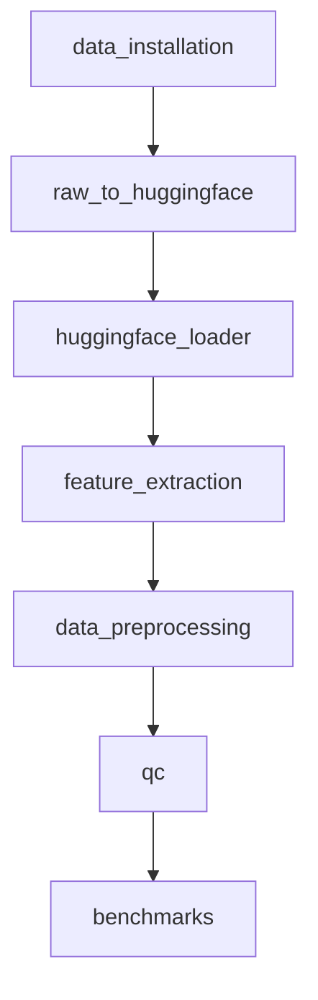
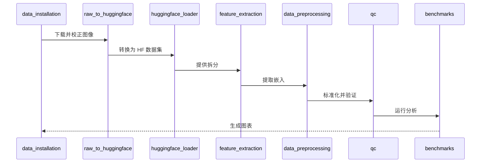

# 架构

**类型：** 流水线

这是一个用于 MorphoHELM Cell Painting 基准测试的数据处理流水线，协调数据下载、预处理、特征提取、标准化、质量控制和基准分析。该系统遵循线性工作流程，每个阶段转换数据并将其传递给下一阶段，执行过程由配置驱动。

## 组件图

## 组件

### data_installation

下载原始显微镜图像并应用光照校正，生成 uint8 PNG 文件作为下游处理的输入。

文件：`data_installation/__init__.py`，`data_installation/cellpainting_io.py`，`data_installation/download_illum_corrected.py`，`data_installation/illumination.py`，`data_installation/manifests.py`

### raw_to_huggingface

将校正后的图像数据集转换为 Hugging Face 数据集格式，以实现高效的加载和拆分。

文件：`raw_to_huggingface/transform_dataset.py`

### huggingface_loader

提供用于创建和管理显微镜图像数据集拆分的工具。

文件：`huggingface_loader/src/cellpainting_huggingface_loader/create_splits.py`

### feature_extraction

使用各种预训练模型对图像进行推理，以提取特征嵌入。

文件：`feature-extraction/src/run_inference.py`，`feature-extraction/src/run_inference_direct.py`，`feature-extraction/src/run_inference_splits.py`，`feature-extraction/src/config.py`，`feature-extraction/src/models/*.py`

### data_preprocessing

使用指定的拆分策略和统计方法对提取的特征进行标准化。

文件：`data-preprocessing/src/normalize_splits.py`，`data-preprocessing/src/normalize_utils.py`

### qc

对细胞数量和数据完整性执行质量控制检查。

文件：`qc/__init__.py`，`qc/build_cell_count_tables.py`，`qc/cell_count_qc.py`

### benchmarks

执行基准分析，包括富集分析、重复分析以及 MOA 预测，生成结果和可视化图表。

文件：`benchmarks/config.py`，`benchmarks/run_benchmark_sweep.py`，`benchmarks/enrichment/*.py`，`benchmarks/qc/*.py`，`benchmarks/replicate_analysis/*.py`

## 序列图

## 数据流

原始显微镜图像被下载并进行光照校正，随后转换为 Hugging Face 数据集。特征提取模型处理这些图像以生成嵌入，这些嵌入经过标准化和质量控制后，用于基准分析，最终生成结果和可视化图表。