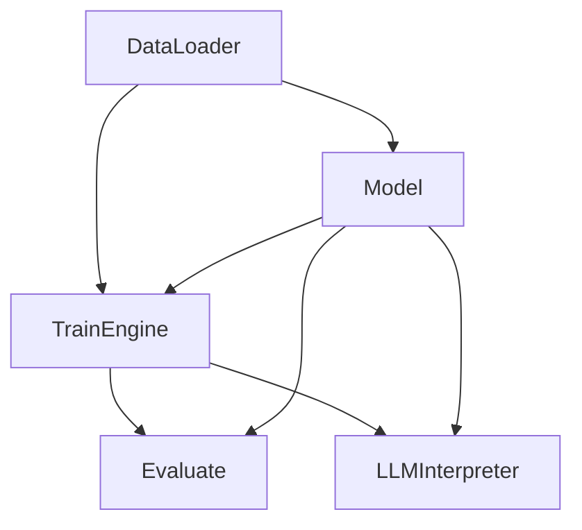
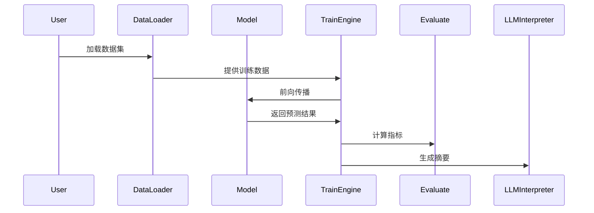

# Architecture

**Type:** framework

这是一个基于PyTorch的深度学习框架，采用混合CNN-ViT架构实现无标签单细胞表型分析。框架通过多任务学习同时处理白细胞分类和蛋白质表达回归，并集成LLM可解释性模块。整体采用模块化设计，包含数据加载、模型训练、评估和摘要生成等独立组件。

## Component Diagram

## Components

### 数据加载模块

处理BSCCM和BCCD数据集的加载与预处理

Files: `data_loading.py`, `bccd_data_loading.py`

### 模型架构

实现混合CNN-ViT网络和任务自适应门控机制

Files: `model.py`

### 训练引擎

管理模型训练流程、损失函数和优化器

Files: `train.py`, `losses.py`

### 评估模块

计算分类准确率和回归相关性指标

Files: `evaluate.py`

### LLM解释器

将预测结果转换为生物学自然语言摘要

Files: `llm_summarizer.py`

## Sequence Diagram

## Data Flow

原始DPC图像数据通过数据加载模块预处理后输入混合CNN-ViT模型。模型输出白细胞分类概率和蛋白质表达回归值，训练引擎计算多任务损失并更新权重。评估模块量化性能指标，LLM解释器将数值预测转换为生物学意义的文本描述。
