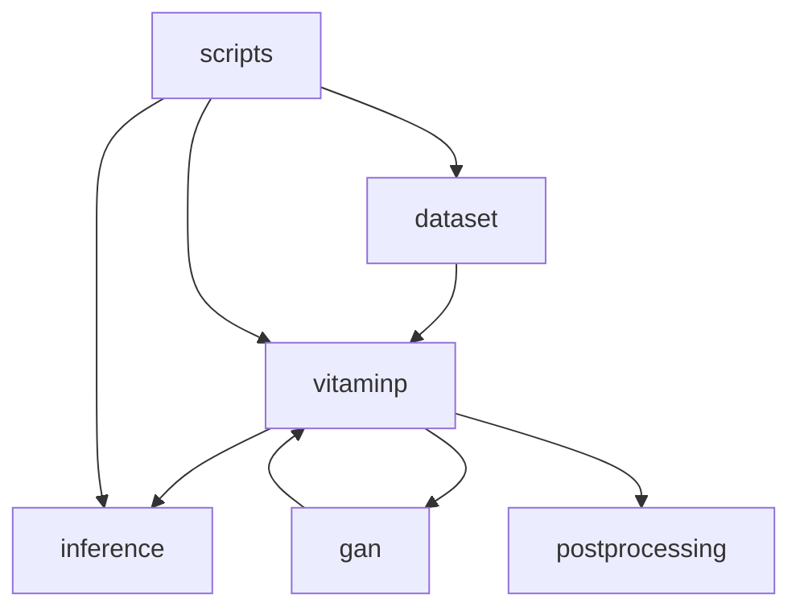
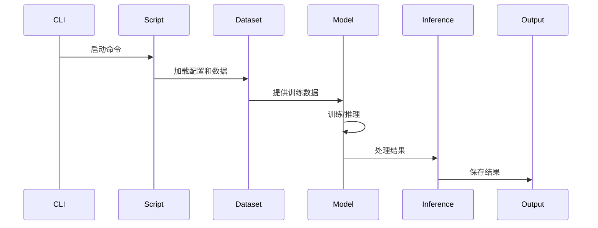

# Architecture

**Type:** library

VitaminP是一个基于PyTorch的细胞分割深度学习库，采用模块化设计，支持多种模型架构和数据处理流程。系统包含数据加载、模型训练、推理和后处理等核心组件，通过配置文件和命令行接口实现灵活使用。

## Component Diagram

## Components

### dataset

数据加载和处理模块，支持多种病理数据集的预处理和批量读取

Files: `dataset/__init__.py`, `dataset/dataset.py`, `dataset/config.py`, `dataset/augmentation.py`

### vitaminp

核心模型实现，包含多种分割模型架构和训练逻辑

Files: `vitaminp/models.py`, `vitaminp/trainer.py`, `vitaminp/backbone.py`, `vitaminp/losses.py`

### inference

推理模块，支持全切片图像处理和结果输出

Files: `vitaminp/inference/predictor.py`, `vitaminp/inference/wsi_handler.py`, `vitaminp/inference/tile_processor.py`

### gan

生成对抗网络模块，用于H&E到MIF图像合成

Files: `vitaminp/gan/models.py`, `vitaminp/gan/losses.py`, `vitaminp/gan/trainer.py`

### postprocessing

后处理模块，包含结果优化和格式转换功能

Files: `postprocessing/hv_postprocess.py`, `postprocessing/utils.py`

### scripts

命令行工具，提供训练、推理和数据处理脚本

Files: `scripts/train.py`, `scripts/train_gan.py`, `scripts/run_wsi_inference.py`

## Sequence Diagram

## Data Flow

数据从原始病理图像开始，经过数据预处理模块转换为Zarr格式存储。训练时数据加载器将图像和标签送入模型进行前向传播和反向传播。推理时WSI被分块处理，模型输出分割结果后通过后处理模块优化，最终保存为GeoJSON等格式。
