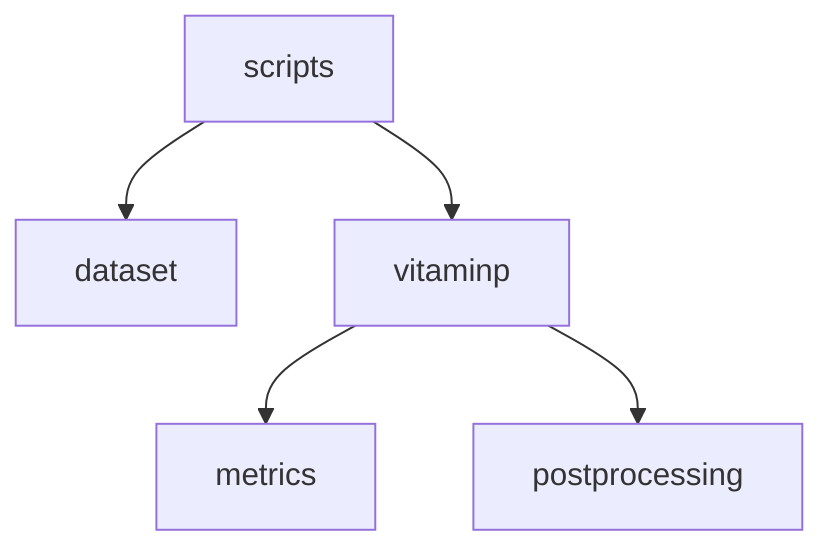

# 模块依赖

## 核心文件（按 PageRank 排序）

1. `vitaminp/__init__.py`
2. `dataset/__init__.py`
3. `vitaminp/gan/__init__.py`
4. `vitaminp/postprocessing/hv_postprocess.py`
5. `metrics/__init__.py`
6. `postprocessing/__init__.py`
7. `vitaminp/inference/constrained_watershed.py`
8. `vitaminp/models.py`
9. `vitaminp/inference/__init__.py`
10. `vitaminp/inference/utils.py`

## 可能的入口点

- `Dockerfile`
- `README.md`
- `dataset/config.py`
- `requirements.txt`
- `scripts/data_preprocessing/README.md`
- `setup.py`
- `scripts/run_wsi_inference.py`
- `scripts/train copy.py`
- `scripts/train.py`
- `scripts/train_gan.py`