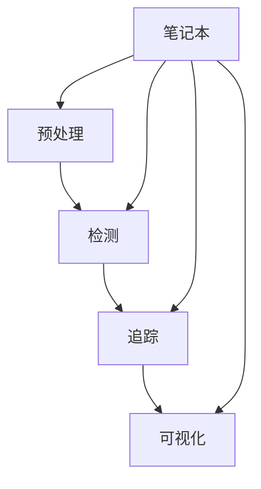

# 架构

**类型：** 流水线

ARGUS 是一个用于显微镜数据细胞追踪的模块化流水线框架，整合了预处理、检测、追踪和可视化组件。每个阶段均可独立使用，或作为完整工作流的一部分，Jupyter 笔记本则提供交互式探索功能。

## 组件图



## 组件

### 预处理

显微镜图像的降噪与亮度校正

文件：`src/algo_funcs.py`，`src/utils.py`

### 检测

利用局部最大值和质心估计识别细胞位置

文件：`src/algo_funcs.py`

### 追踪

通过光流和基于距离的关联跨帧链接细胞检测

文件：`src/algo_funcs.py`，`src/ctc_reformat.py`

### 可视化

生成叠加图、MSD 分析以及追踪结果的视频输出

文件：`src/display_funcs.py`，`src/parameter_scan.py`

### 笔记本

用于演示和分析的交互式 Jupyter 笔记本

文件：`notebooks/compute_cell_paths.ipynb`，`notebooks/format_tracks_for_CTC.ipynb`

## 序列图

```mermaid
sequenceDiagram
  participant 用户
  participant 笔记本
  participant 预处理
  participant 检测
  participant 追踪
  participant 可视化
  用户->>笔记本：加载数据
  笔记本->>预处理：应用降噪
  预处理-->>笔记本：清洗后的图像
  笔记本->>检测：查找细胞
  检测-->>笔记本：细胞位置
  笔记本->>追踪：链接位置
  追踪-->>笔记本：轨迹
  笔记本->>可视化：生成输出
  可视化-->>用户：结果
```

## 数据流

原始显微镜图像首先进入预处理阶段进行降噪和校正。随后，跨帧链接检测到的细胞位置以生成轨迹，最终通过叠加图、MSD 分析和视频生成进行可视化。