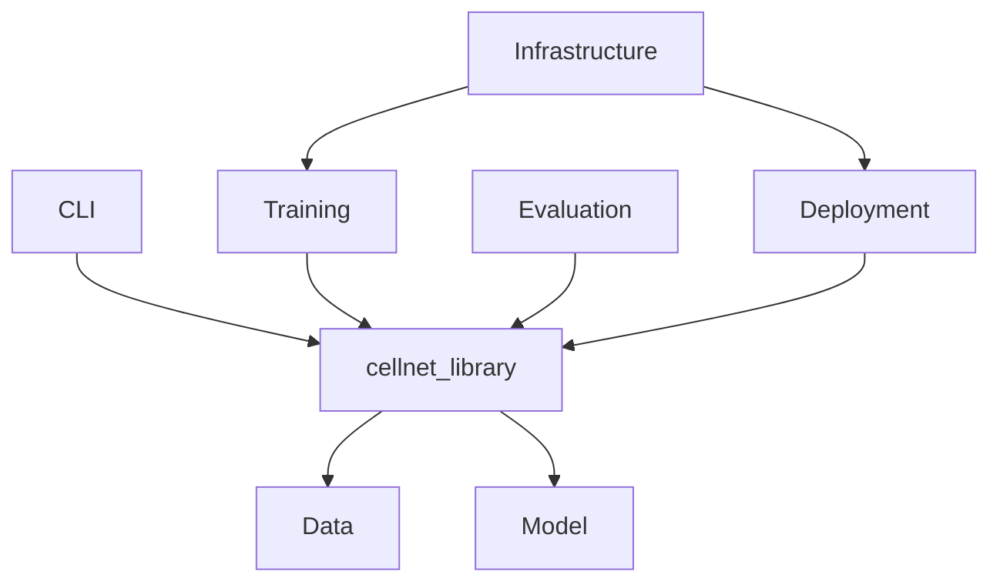
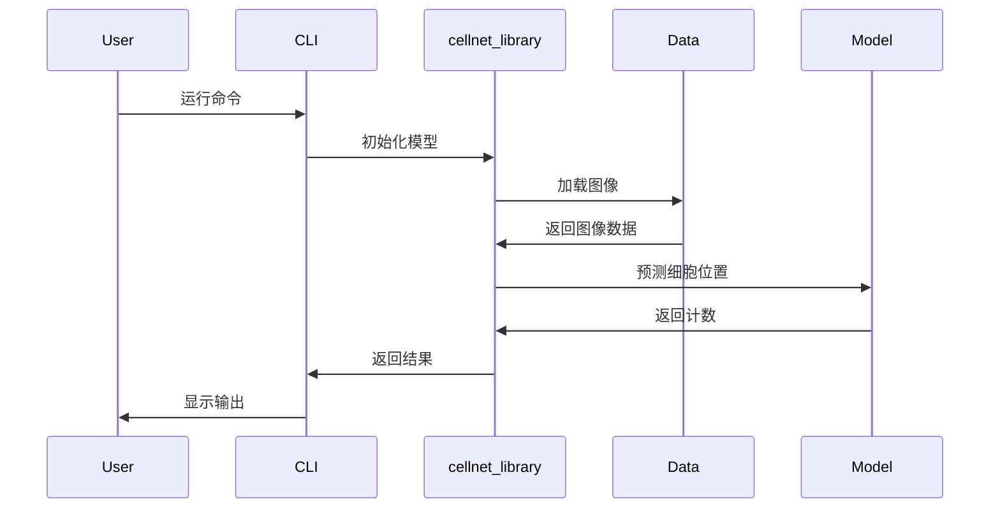

# 架构

**类型：** 命令行工具

这是一个用于在显微镜图像中基于稀疏点标注进行细胞定位的命令行工具。它提供了用于推理、训练和模型发布管理的 Python 模块接口和命令行界面（CLI）。该架构围绕核心库（cellnet）组织，并配有用于数据准备、训练和部署的辅助脚本。

## 组件图

## 组件

### cellnet_library

提供模型初始化和细胞计数功能的核心库

文件：`cellnet/__init__.py`, `cellnet/data.py`, `cellnet/internet.py`, `cellnet/plot.py`, `cellnet/evaluate.py`, `cellnet/debug.py`, `cellnet/release.py`

### training_pipeline

用于数据预处理和模型训练的脚本与工具

文件：`train.py`, `train_livecell.py`, `preprocess_annotations.py`, `preprocess_annotations_livecell.py`

### evaluation_suite

针对不同数据集的评估脚本

文件：`eval.py`, `eval_countess.py`, `eval_livecell.py`

### deployment_tools

用于模型发布和测试的 CLI 工具

文件：`cellnet/release.py`, `bin/test-release`, `bin/release`

### infrastructure_scripts

高性能计算（HPC）作业提交和数据同步工具

文件：`bin/submit-job`, `bin/job-ipynb`, `bin/data-sync`, `bin/clean`, `bin/install`, `bin/normalize_paths`

## 序列图

## 数据流

主要数据流始于通过 CLI 或 Python 模块的用户输入，该输入会初始化模型并加载图像数据。模型处理图像以预测细胞位置，返回计数和可视化图表。训练数据流经预处理脚本，在用于训练流程之前将标注格式进行转换。