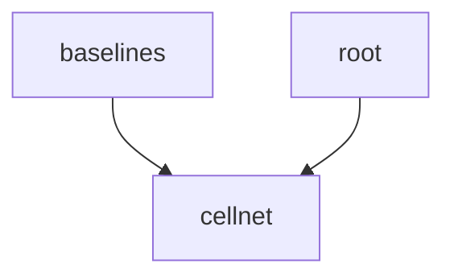

# 模块依赖

## 核心文件（按 PageRank 排序）

1. `cellnet/data.py`
2. `cellnet/__init__.py`
3. `cellnet/plot.py`
4. `cellnet/evaluate.py`
5. `cellnet/internet.py`
6. `cellnet/debug.py`
7. `cellnet/release.py`
8. `README.md`
9. `pyproject.toml`
10. `bin/clean`

## 可能的入口点

- `README.md`
- `pyproject.toml`
- `bin/clean`
- `bin/code-tunnel`
- `bin/data-sync`
- `bin/imports.sh`
- `bin/install`
- `bin/job-ipynb`
- `bin/normalize_paths`
- `bin/release`