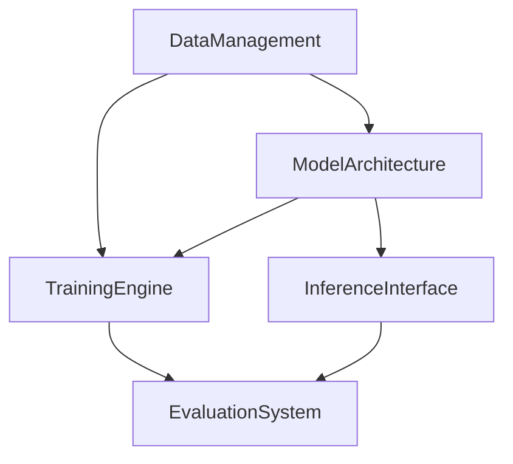
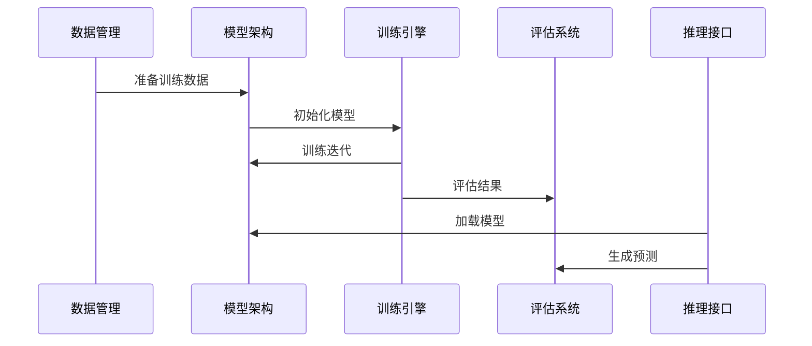

# Architecture

**Type:** pipeline

这是一个基于深度学习的计算机视觉模型训练与推理系统，采用模块化流水线架构。系统包含数据预处理、模型构建、训练优化、评估验证和推理部署等核心组件，支持跨域文本引导的目标计数任务。

## Component Diagram

## Components

### 数据管理

处理多源数据集的下载、转换、重建和审计

Files: `data/tools/convert_all_sources.py`, `data/tools/rebuild_restricted_derived_images.py`, `data/tools/audit_annotation_image_paths.py`

### 模型架构

实现Count Anything核心模型和SAM3基础模型

Files: `count_anything/model/count_anything.py`, `count_anything/model/fusion.py`, `sam3/model/sam3_image.py`, `sam3/model/decoder.py`, `sam3/model/encoder.py`

### 训练引擎

提供训练循环、损失函数和优化器配置

Files: `count_anything/train/train.py`, `count_anything/train/trainer.py`, `sam3/train/trainer.py`, `sam3/train/loss/sam3_loss.py`

### 评估系统

执行模型评估、指标计算和结果可视化

Files: `count_anything/eval/counting_meter.py`, `count_anything/eval/postprocessor.py`, `sam3/eval/counting_meter.py`

### 推理接口

提供模型推理和预测功能

Files: `count_anything/inference.py`, `sam3/sam3_video_inference.py`, `sam3/sam3_image_processor.py`

## Sequence Diagram

## Data Flow

原始图像数据通过数据管理模块进行下载、转换和重建，形成统一的CLOC数据集格式。模型架构模块加载预训练的SAM3基础模型并构建Count Anything专用计数头。训练引擎使用多源损失函数进行端到端训练，评估系统计算计数指标并可视化结果。推理接口接收图像和文本查询，输出实例化点预测。
