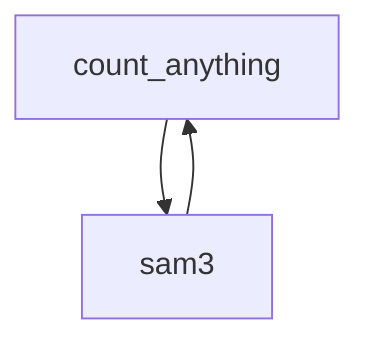

# 模块依赖

## 核心文件（按 PageRank 排序）

1. `sam3/model/box_ops.py`
2. `sam3/model/data_misc.py`
3. `sam3/train/utils/train_utils.py`
4. `sam3/perflib/triton/connected_components.py`
5. `sam3/train/data/sam3_image_dataset.py`
6. `sam3/train/utils/distributed.py`
7. `sam3/model/__init__.py`
8. `sam3/perflib/connected_components.py`
9. `sam3/train/loss/loss_fns.py`
10. `count_anything/model/pixel_dense_counter.py`

## 可能的入口点

- `README.md`
- `data/README.md`
- `requirements.txt`
- `.codegraph/.gitignore`
- `.github/workflows/format.yml`
- `.gitignore`
- `LICENSE`
- `README_CN.md`
- `config/count_anything_test_cloc.yaml`
- `config/count_anything_train_cloc.yaml`