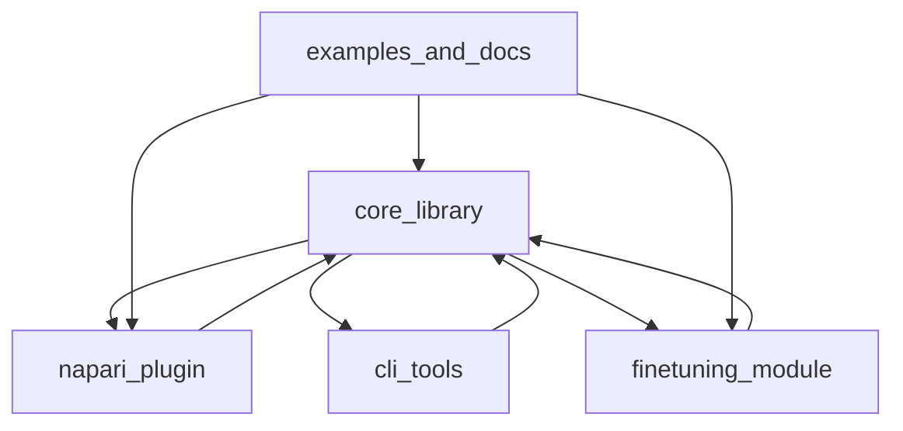
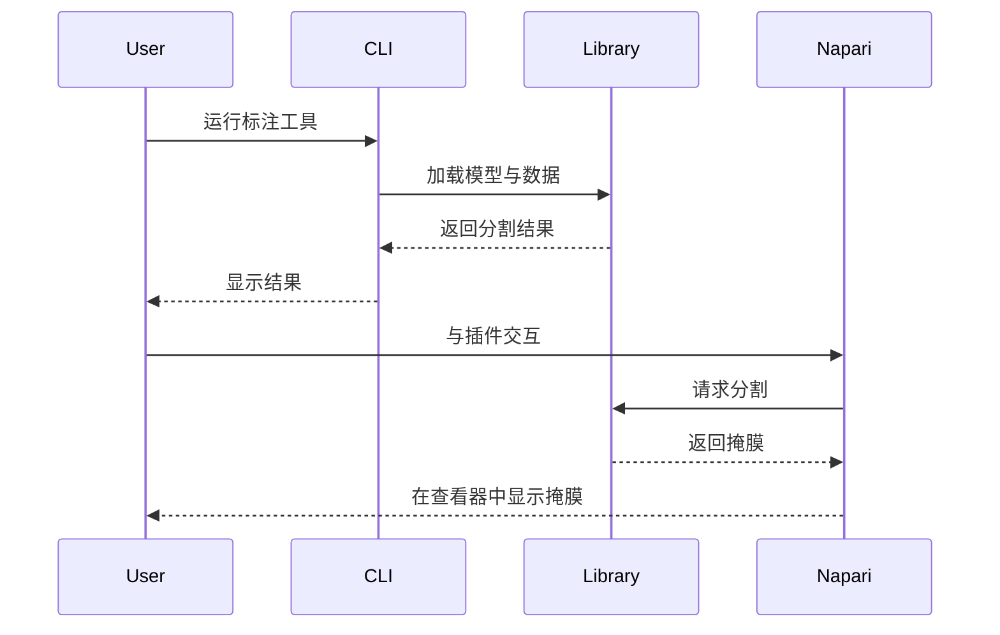

# 架构

**类型：** 库

micro-sam 是一个基于 Segment Anything 构建的 Python 库，用于显微图像的分割与跟踪。它既提供了用于交互式标注的 napari 插件，也提供了用于自动分割、微调与评估的命令行工具。

## 组件图

## 组件

### core_library

提供分割与跟踪功能的核心 Python 库

文件：`micro_sam/__init__.py`、`micro_sam/automatic_segmentation.py`、`micro_sam/precompute_state.py`、`micro_sam/training/training.py`、`micro_sam/evaluation/evaluation.py`

### napari_plugin

用于在 napari 中进行 2D、3D 及跟踪交互式标注的工具

文件：`micro_sam/sam_annotator/annotator_2d.py`、`micro_sam/sam_annotator/annotator_3d.py`、`micro_sam/sam_annotator/annotator_tracking.py`、`micro_sam/sam_annotator/image_series_annotator.py`

### cli_tools

用于批量处理与自动化的命令行界面

文件：`micro_sam/cli_tools.py`、`scripts/apg_experiments/*.py`、`scripts/model_export/*.py`

### finetuning_module

面向显微数据的模型微调与评估模块

文件：`finetuning/livecell_finetuning.py`、`finetuning/evaluation/*.py`、`finetuning/generalists/training/*.py`、`finetuning/specialists/training/*.py`

### examples_and_docs

面向用户的示例脚本、笔记本与文档

文件：`examples/*.py`、`notebooks/*.ipynb`、`doc/*.md`、`workshops/*/README.md`

## 序列图

## 数据流

用户输入（图像、提示）通过 CLI 或 napari 插件流入核心库，核心库利用预计算嵌入和 SAM 模型对其进行处理。结果（分割掩膜、跟踪结果）会返回给用户界面或保存至文件。微调工作流遵循类似模式，但涉及训练数据与评估指标。