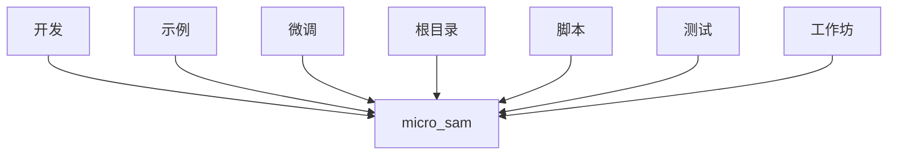

# 模块依赖

## 核心文件（按 PageRank 排序）

1. `micro_sam/util.py`
2. `micro_sam/__init__.py`
3. `micro_sam/training/__init__.py`
4. `micro_sam/models/build_sam.py`
5. `micro_sam/sam_annotator/__init__.py`
6. `micro_sam/evaluation/livecell.py`
7. `micro_sam/evaluation/__init__.py`
8. `micro_sam/bioimageio/__init__.py`
9. `micro_sam/training/util.py`
10. `micro_sam/sample_data.py`

## 可能的入口点

- `README.md`
- `development/README.md`
- `examples/README.md`
- `examples/finetuning/README.md`
- `finetuning/README.md`
- `finetuning/evaluation/README.md`
- `finetuning/generalists/README.md`
- `finetuning/generalists/training/README.md`
- `finetuning/specialists/README.md`
- `finetuning/specialists/outdated/livecell/README.md`