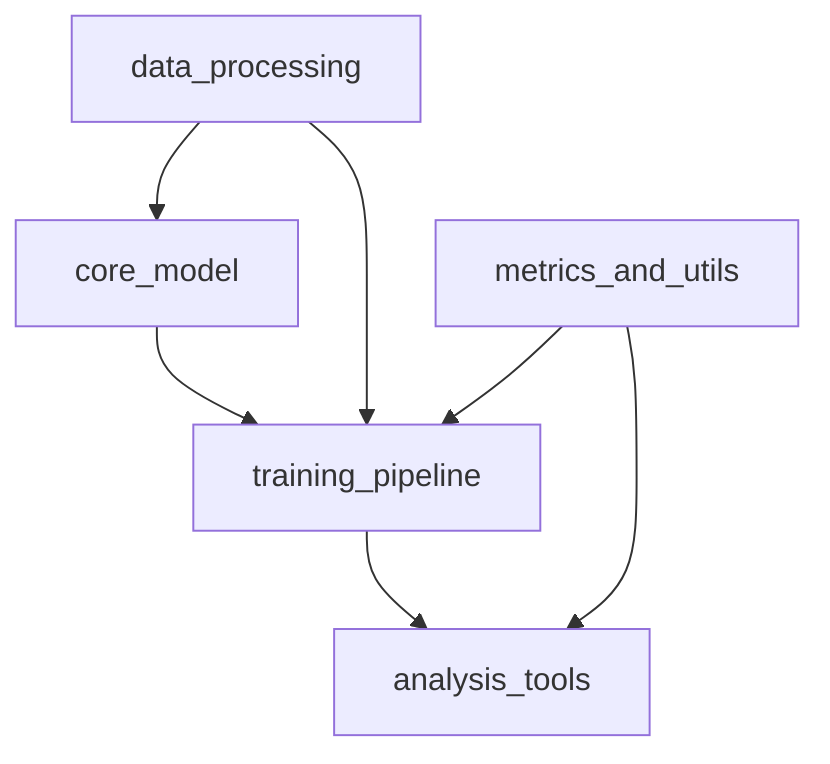
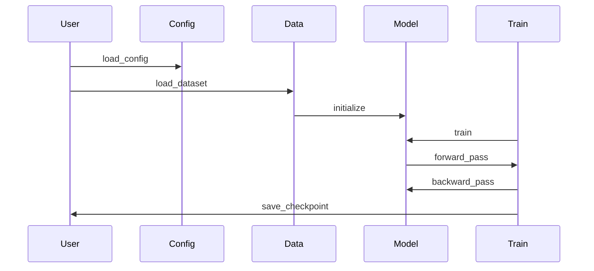

# 架构

**类型：** 库

UCell 是一个用于细胞分割的库，采用基于 Transformer 的模型并支持 LoRA 微调功能。它为专注于生物图像分割的深度学习模型提供训练、预测和分析工具。

## 组件图

## 组件

### core_model

定义神经网络架构，包括层、动态机制和 LoRA 适配器

文件：`ucell/layers.py`、`ucell/dynamics.py`、`ucell/frm.py`、`ucell/lora.py`

### training_pipeline

负责模型训练、配置和检查点管理

文件：`train.py`、`config.py`、`eval.py`、`predict.py`

### data_processing

管理数据集加载、预处理以及细胞分割的任务映射

文件：`data.py`、`ucell/utils.py`

### analysis_tools

提供神经元死亡检测及模型诊断分析工具

文件：`dead_neuron_analysis/detect_dead_neurons.py`、`dead_neuron_analysis/analyze_neurons_advanced.py`

### metrics_and_utils

计算评估指标并提供辅助函数

文件：`ucell/metrics.py`、`ucell/utils.py`

## 序列图

## 数据流

配置定义模型架构和训练参数。数据处理加载并预处理图像数据集。核心模型通过 Transformer 层处理图像，并可选择性地使用 LoRA 适配器。训练流程协调前向/后向传播及检查点保存。分析工具在推理期间监控神经元活动。