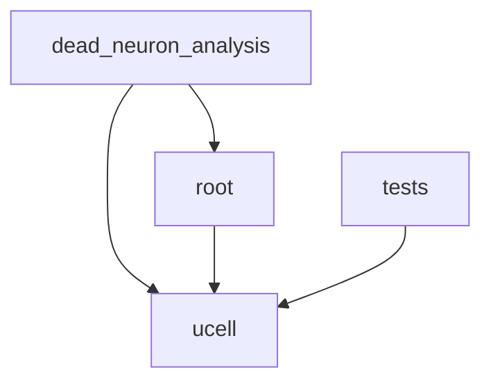

# 模块依赖

## 核心文件（按 PageRank 排序）

1. `ucell/frm.py`
2. `ucell/utils.py`
3. `ucell/dynamics.py`
4. `data.py`
5. `ucell/metrics.py`
6. `ucell/lora.py`
7. `ucell/layers.py`
8. `README.md`
9. `config.py`
10. `dead_neuron_analysis/README.md`

## 可能的入口点

- `README.md`
- `config.py`
- `dead_neuron_analysis/README.md`
- `pyproject.toml`
- `.codegraph/.gitignore`
- `.gitignore`
- `dead_neuron_analysis/analyze_neurons_advanced.py`
- `dead_neuron_analysis/detect_dead_neurons.py`
- `eval.py`
- `few_shot_adapt.py`