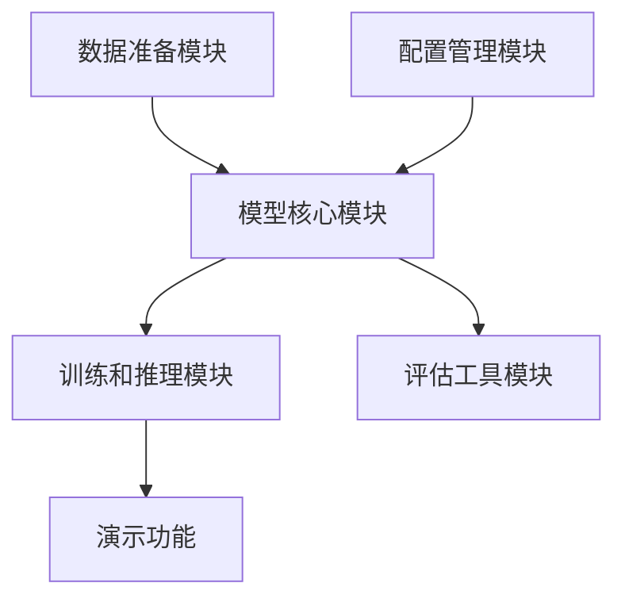
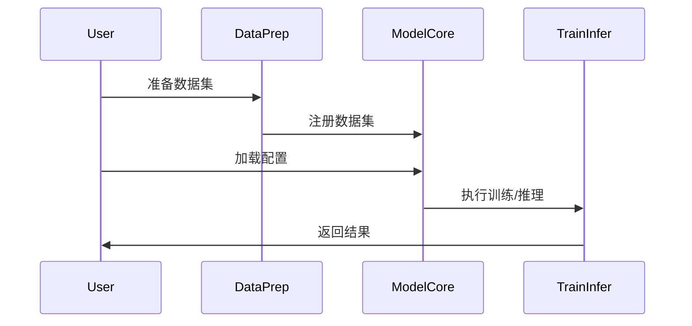

# Architecture

**Type:** pipeline

这是一个基于Mask2Former的语义分割和实例分割深度学习模型架构，采用Detectron2框架实现。系统包含数据准备、模型训练、推理演示和评估工具等组件，支持多种数据集和 backbone 配置。

## Component Diagram

## Components

### 数据准备模块

准备和注册数据集，支持ADE20k、COCO、Cityscapes等数据集

Files: `datasets/prepare_ade20k_ins_seg.py`, `datasets/prepare_ade20k_pan_seg.py`, `datasets/prepare_ade20k_sem_seg.py`, `datasets/register_*.py`

### 模型核心模块

实现Mask2Former模型架构，包括backbone、pixel decoder、transformer decoder等

Files: `mask2former/modeling/backbone/swin.py`, `mask2former/modeling/pixel_decoder/fpn.py`, `mask2former/modeling/transformer_decoder/mask2former_transformer_decoder.py`, `mask2former/maskformer_model.py`

### 配置管理模块

管理模型训练和推理的配置参数

Files: `mask2former/config.py`, `configs/ade20k/semantic-segmentation/maskformer2_swin_tiny_bs16_160k.yaml`

### 训练和推理模块

提供模型训练、测试和演示功能

Files: `train_net.py`, `demo/predictor.py`, `demo_video/predictor.py`

### 评估工具模块

提供模型性能评估工具

Files: `mask2former/evaluation/evaluator.py`, `mask2former/evaluation/instance_evaluation.py`, `tools/evaluate_pq_for_semantic_segmentation.py`

## Sequence Diagram

## Data Flow

数据首先通过数据准备模块进行预处理和注册，然后由模型核心模块加载配置进行训练或推理。训练过程中，模型从数据集读取图像和标注，经过backbone提取特征，通过pixel decoder和transformer decoder生成预测结果。最终输出可以通过评估工具进行性能分析，或通过演示模块进行可视化展示。
