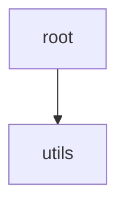

# Module Dependencies

## Core Files (by PageRank)

1. `main_seg.py`
2. `att_dataset_seg.py`
3. `evaluation_loop.py`
4. `modelsseg.py`
5. `utils/utils_torch.py`
6. `multi_task_loss.py`
7. `predict_att.py`
8. `utils/average_value_tracker.py`
9. `utils/logger.py`
10. `utils/utils.py`

## Likely Entry Points

- `Mask2Former/README.md`
- `Mask2Former/datasets/README.md`
- `Mask2Former/demo/README.md`
- `Mask2Former/demo_video/README.md`
- `Mask2Former/mask2former/config.py`
- `Mask2Former/mask2former/modeling/pixel_decoder/ops/setup.py`
- `Mask2Former/mask2former_video/config.py`
- `Mask2Former/requirements.txt`
- `Mask2Former/tools/README.md`
- `README.md`
